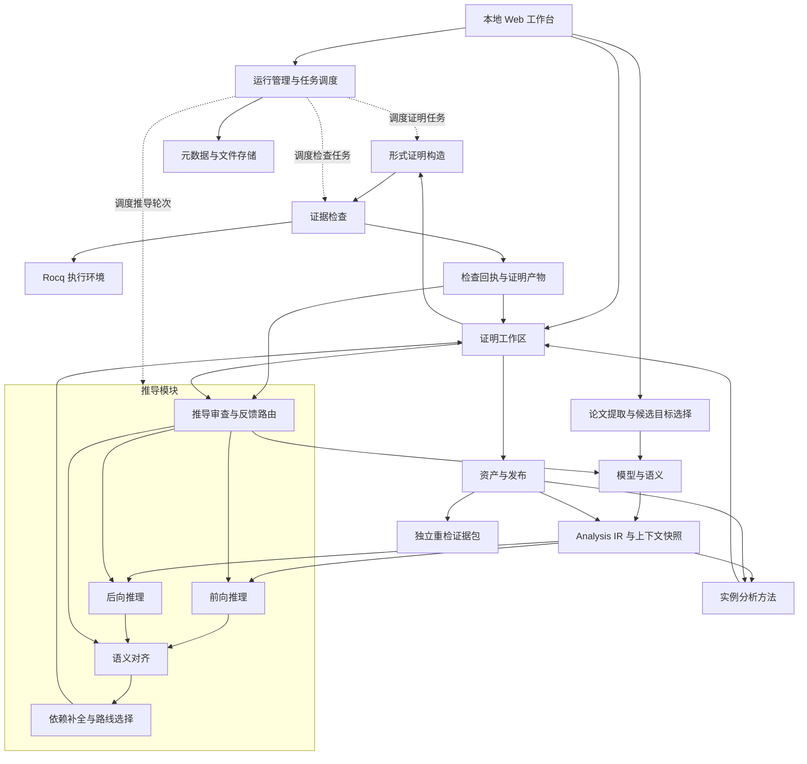
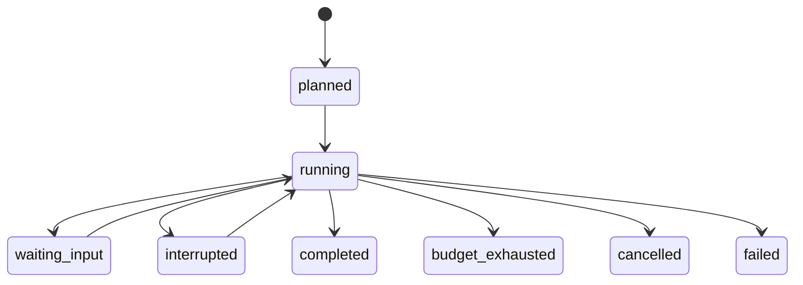
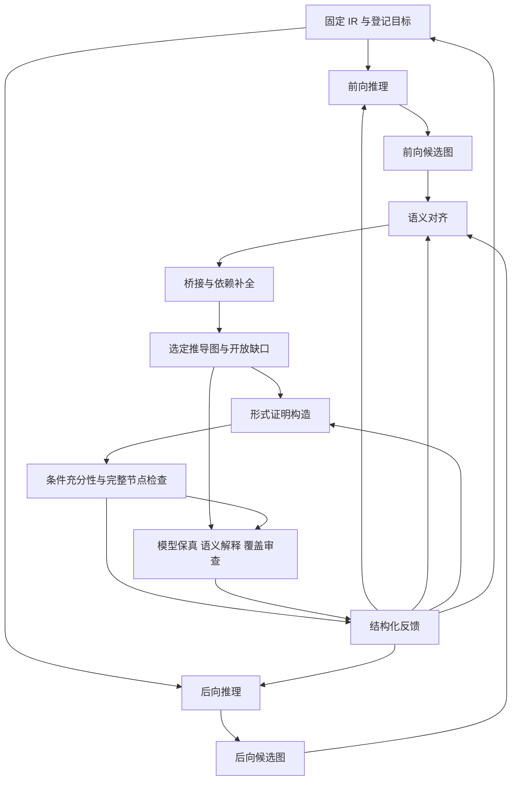

# 实时系统分析与证明平台软件设计书

版本 v0.6　设计提案　2026 年 11 月 5 日

面向项目负责人、实时系统研究人员、形式化工程师和软件开发者。

平台围绕实时系统分析方法的构建、审查、形式证明与复用展开，并支持把经过验证的方法应用到具体任务集。**双向推理、语义对齐和依赖补全组成平台的核心推导模块**，位于 Analysis IR 与形式证明构造之间。首轮开发同时固定模型、目标、推导和证据合同，以一个方法级目标贯穿双向推导、对齐、检查和修订，再扩展方法库与协作功能。

用户已确认首版通过本地 Web 工作台导入数字版论文 PDF，平台提取模型、分析方法和候选目标，由用户选择一项或多项后独立构建证明。流程自动推进，关键数学决策由用户确认。首版模型主线已选择单处理器 FP／DM，贯穿案例为 case_11，发布验收至少完成一个主要目标的完整形式证明。用户可修改抽取、模型与目标，以自然语言反馈修订推导；部分结果可在调整后用于关联新运行并比较结果。主要目标已固定为整数时间零星 DM 模型下的 Fig.3 接受充分性，采用基础定义与通用引理独立构建。数据本地保存，允许配置模型 API；运行限额在首次调用前设置。本文的接口、目录和技术栈仍为设计方案，原排期在新增 PDF 与 Web 验收范围确定后重新估算。

## 1 产品目标与交付范围

### 1.1 两条用户工作流

| 工作流 | 主要用户 | 输入 | 最终交付 |
|---|---|---|---|
| 分析方法构建 | 研究人员、形式化工程师 | 模型、公式、算法、目标保证、来源材料 | 明确的适用条件、定理与引理、完整或待完成的证明义务、方法发布包 |
| 具体实例分析 | 分析方法使用者 | 任务集、处理器配置、调度策略、方法版本 | 计算结果、适用性检查、逐目标证明证书、可独立重检的证据包 |

平台的研究主线是方法构建。方法级主路径包含独立前向推理、独立后向推理、语义对齐、依赖补全、形式证明和反馈修订。实例分析提供一条较容易校准的辅助路径，用于验证语义转换、数值计算、定理实例化和证据检查的连接。两条路径共用目标、证明任务、版本与证据机制。

POET 已实现任务集输入、响应时间分析、逐任务证书生成及 Rocq 检查。平台参考其证据交付方式，并将方法开发、目标修订和证明资产管理纳入自己的设计。[POET 官方说明](https://prosa.mpi-sws.org/poet/)

### 1.2 用户故事与可观察结果

| 编号 | 用户故事 | 完成条件 |
|---|---|---|
| U01 | 我提交一个分析目标，并说明它依赖的模型和条件 | 系统保存精确目标、上下文版本、来源及语义审核状态 |
| U02 | 我希望把目标拆成可分别处理的引理 | 联合前提、替代推导和选定证明路线均可查询 |
| U03 | 我希望平台构造证明，并根据我的反馈修订 | 系统保存反馈、证明尝试和结构化检查结果 |
| U04 | 我修改一个条件，想知道哪些结果需要重检 | 系统列出受影响的目标和证据，并保留历史版本 |
| U05 | 我希望使用已发布方法分析任务集 | 系统检查适用条件，输出计算结果与证书状态 |
| U06 | 我将结果交给另一位研究者复核 | 对方能在锁定环境中重新检查证据包 |
| U07 | 本轮未完成后，我希望调整条件或预算继续处理 | 关联新运行保留父运行、适用证据与缺口，并能比较结果和费用 |
| U08 | 我需要判断自动推理是否有效 | 能分别查询目标证明、辅助引理、人工介入和成本指标 |
| U09 | 我希望双向推导在同一模型下独立展开，再建立数学连接 | 两个初始候选图、对齐关系、桥接义务和选定路线均保留 |
| U10 | 我希望失败反馈返回需要修订的推导阶段 | 修订任务指向具体节点、原因和负责阶段，下一轮有对应处理记录 |

### 1.3 能力分期

| 首个完整版本 | 第二阶段 | 后续扩展 |
|---|---|---|
| 数字版 PDF 导入、来源定位、候选目标选择、MSA 与 IR 生成 | 扩大论文与公式覆盖范围 | 多文档语义整理 |
| 一个模型族和一个分析方法 | 第二种分析方法或第二个模型族 | 多处理器、连续时间、资源共享等 |
| 双向推理、语义对齐、依赖补全和一轮反馈修订，支持人工及模型提案 | 更强的检索、搜索策略和修订优化 | 多策略并行搜索与跨案例复用 |
| Rocq 证明检查 | 有明确用途的辅助求解器 | 多证明后端的语义适配 |
| 本地 Web 工作台、输入编辑、自然语言反馈、关联运行比较与证据包 | 图与证明编辑等交互扩展、资产检索 | 多人权限、共享执行资源 |

每种新增模型组合都需要明确语义、方法适用条件及验证案例。模型支持范围由能力清单描述，用户可以在运行前查询。

## 2 软件设计的起点

正式开发前形成五项合同，并用同一个案例检查它们能否连接。

| 合同 | 要回答的问题 | 首轮产出 |
|---|---|---|
| 模型合同 | 时间、作业、调度和完成分别意味着什么 | 一份模型规格和对应形式定义 |
| 目标合同 | 最终究竟要证明哪个命题 | 固定目标声明、量词、上下文及来源映射 |
| 方法合同 | 算法适用于何种输入，返回值表达什么 | 输入检查、计算规则、停止条件和正确性依据 |
| 推导合同 | 两个方向产生什么，如何连接，何时形成证明任务 | 候选图、联合前提、对齐关系、桥接义务、缺口与反馈路由 |
| 证据合同 | 何种产物能够支持哪个结果状态 | 证明检查规则、依赖策略和独立重检入口 |

软件开发从证据消费端倒推，同时定义推导合同。先让检查器接收一个已知正确的证明并拒绝错误目标，再让人工或记录提案走通两个方向、对齐、依赖补全和证明任务。随后接入真实模型调用。每增加一层能力，都通过同一套目标与证据验收接口观察结果。

### 2.1 首个贯穿案例

产品验收采用用户选定的 case_11《Hard Real-Time Scheduling: The Deadline-Monotonic Approach》，从原始数字版 PDF 提取到完整主要目标证明贯通。样本与来源记录位于 `examples/papers/case_11/`。目标与模型见 [数学合同](../contracts/case11-integer-dm-soundness.zh.md)，原文解释、整数模型变体和检查结果分别记录。

以下双任务数据作为底层分析与检查的工程样例。方法级验收依据所选论文的主要目标，至少一个主要目标取得完整证据。

设计用例采用以下明确模型。

- 单处理器、单位执行速度、离散自然数时间。
- 相互独立的 sporadic 任务，执行需求上界为正整数。
- 完全抢占、固定任务优先级、工作保持调度，优先级形成严格全序。
- 从空系统开始，任意合法零星释放；无阻塞与自挂起，调度和抢占开销按零建模。
- 受限截止期，满足 `0 < C_i <= D_i <= T_i`。
- DM 按相对截止期及固定任务顺序排序；服务与完成端点、同任务作业选择按数学合同编码。
- 任务的执行参数被视为输入假设，其现实测量或 WCET 分析来源随项目记录。

示例任务如下，所有数值使用同一时间单位。

| 任务 | C | D | T | 优先级 |
|---|---:|---:|---:|---|
| τ1 | 1 | 4 | 4 | 高 |
| τ2 | 2 | 5 | 5 | 低 |

用于验收的计算轨迹采用论文 Fig.3 的初值与接受条件。

```text
t_i,0 = Σ_{j≤i} C_j
W_i(t) = C_i + Σ_{j<i} ceil(t / T_j) × C_j
仅在 t≤D_i 且 W_i(t)≤t 时接受，否则按合同更新或停止

τ1 在初值 t=1 接受，W_1(1)=1
τ2 在初值 t=3 接受，W_2(3)=3
```

这组数值用于检查计算与模型绑定。调度保证由独立构建的主要目标及实例前提建立。首轮核对允许的定义与通用引理、端点和优先级约定，形成逐项映射；额外限制按目标变体处理。现成 RTA 主定理及包装不计入本次独立构建验收。

主要方法目标是全部任务接受蕴含所有合法作业按期完成。双任务实例与简单辅助命题用于证据接口的工程夹具；初始候选图与主目标推导由独立两支生成。工程回放、辅助证明与真实主目标运行分别记录，并通过统一的目标与证据接口检查。

### 2.2 第一轮验证问题

1. 能否从固定输入产生精确目标，并由独立检查过程确认目标一致？
2. 能否把任务集数据、参数合法性和分析条件连接到实例定理？
3. 能否在保留同一命题身份的同时记录失败和成功证明尝试？
4. 修改 C、优先级或假设后，哪些证据会被判为需要重检？
5. 关闭应用后，第三方能否仅凭证据包和锁定环境重检？
6. 两个方向的初始输入是否隔离，后向自身的有效推导是否得到保留？
7. 对齐是否明确量词、参数和蕴含方向，缺失条件是否形成可追踪义务？
8. 一次证明失败是否能返回对应推导阶段，补齐后再次检查原目标？

## 3 核心设计原则与架构决定

采用 mattpocock-skills 的深模块思路。一个模块通过较小的 Interface 承载完整职责，将复杂性集中在 Implementation 内部。Interface 同时包含参数、返回结果、不变量、调用顺序、错误和资源约束。Seam 表示可替换行为的位置，Adapter 表示在该位置实现接口的具体实现。

| 决定 | 采用方案 | 理由与代价 | 重新评估的触发条件 |
|---|---|---|---|
| D01 部署方式 | 模块化应用加独立 Worker | 保持事务和调试路径清晰，计算进程单独限额 | 多团队独立发布或执行集群形成 |
| D02 核心组织 | 围绕语义、推导、工作区、证明构造、证据和运行划分模块 | 数学探索、共享状态、脚本构造与验收各有归属 | 接口变化持续跨越多个模块 |
| D03 首个后端 | Rocq 与经过核实的基础定义及通用引理 | 主目标独立构建，库使用清单与实际依赖可检查 | 出现明确需要其他逻辑或工具的案例 |
| D04 形式表示 | 领域表达式加后端形式文件 | 用户语义可解释，后端表达能力充分 | 第二个模型族暴露表示缺口 |
| D05 推导实现 | 双向推理与对齐拥有固定合同，人工与模型 Adapter 共用入口 | 核心推导流程可测试，调用策略可替换 | 真实运行暴露不同交互需求 |
| D06 持久化 | PostgreSQL 元数据加内容寻址文件存储 | 支持事务、并发和大产物分离 | 需要远程对象存储或跨区域使用 |
| D07 可信结果 | 由检查模块产生证据回执 | 生成者只提交候选，结果判定集中 | 新证据类型需要不同检查策略 |
| D08 复用 | 精确上下文匹配或显式实例化证明 | 复用依据可以被检查 | 语义等价判定带来实际收益 |

模块接口先覆盖实际的人工输入、自动提案、真实工具及故障测试路径。新的替换点由具体需求推动，生产 Adapter 与有明确目的的测试 Adapter 共同检验接口是否成立。

## 4 总体架构与职责



图中的箭头表达主要数据流。模块间通过明确的值对象和命令交互，数据库写入由拥有相应记录的模块执行。

| 模块 | 拥有的数据与行为 | 主要 Interface | 内部隐藏的复杂性 |
|---|---|---|---|
| 论文导入与提取 | 原始 PDF、抽取版本、来源位置、候选保证、推理可见材料 | `import_paper`、`prepare_source_package` | 多栏与公式提取、来源角色、候选识别和材料范围控制 |
| 模型与语义 | 来源、模型修订、假设、目标声明、语义问题 | `prepare_context`、`commit_revision` | 单位、作用域、类型、来源映射、模型合法性 |
| 分析方法 | 方法合同、输入适用性、数值轨迹、实例目标 | `analyze` | 精确算术、固定点、停止判断、方法实例化 |
| 推导模块 | 双向候选、对齐提案、桥接与补全策略、审查和修订计划 | `derive`、`refine` | 前向推理、后向推理、语义对齐、缺口诊断和修订路由 |
| 证明工作区 | 命题、候选图、联合前提、对齐记录、选定路线和任务需求的持久状态 | `submit_proposal`、`plan_obligations`、`attach_evidence` | 结构校验、版本提交、循环诊断、依赖闭包、失效传播 |
| 形式证明构造 | 选定推导对应的证明源码与修复提案 | `construct` | 定理实例化、证明步骤、工具诊断解释和脚本修复 |
| 证据检查 | 工具输入、证明产物、实际依赖、检查回执 | `check`、`recheck_bundle` | 环境搭建、精确目标检查、假设审计、进程隔离 |
| 运行管理 | 任务、尝试、租约、取消、预算、执行事件 | `start`、`control`、`inspect` | 并发、恢复、幂等提交、费用记账 |
| 资产与发布 | 可复用模型和方法版本、发布清单、证据包 | `find_assets`、`publish`、`export_bundle` | 适用条件筛选、版本锁定、证据归集 |

推导模块生成数学提案，证明工作区校验结构并保存可追溯版本。形式证明构造把选定推导转成可执行证明。证据检查模块运行真实工具并产生回执，工作区据此关联证据。运行管理执行依赖调度、预算和恢复，数学任务的分解与反馈归属由推导模块提出。

这条方法级主路径从 IR 和目标直接进入双向推导。实例分析模块处理具体任务集的数值计算，它生成的实例目标也进入同一工作区。前向推理可以使用分析表达式和运算关系，具体任务集求值由分析方法模块承担。

## 5 领域模型与版本规则

### 5.1 核心对象

| 对象 | 核心字段 | 必须保持的不变量 |
|---|---|---|
| Project | 身份、名称、负责人、默认策略 | 所有项目资源归属明确 |
| SourceArtifact | 文件摘要、定位、来源类型 | 引用指向固定内容与可定位片段 |
| ModelRevision | 模型族、定义摘要、参数结构、父版本 | 已提交的数学内容不可变 |
| ContextSnapshot | 模型版本、假设集合、库锁、基础策略 | 快照摘要覆盖全部语义依赖 |
| ClaimRevision | 命题身份、目标角色、形式陈述、上下文、来源 | 陈述变更产生新修订 |
| Assumption | 命题、来源、作用范围、采用依据 | 原始条件与额外限制可区分 |
| Derivation | 联合前提、结论、上下文映射、论证内容 | 一条推导表达完整的充分性要求 |
| ReasoningRound | 上下文、目标修订、两个方向的输入清单、策略和轮次 | 初始两个方向共享固定 IR，分别记录可见内容 |
| CandidateGraphRevision | 前向或后向来源、节点、推导、根、所属轮次 | 候选完整保存，原目标身份可追溯 |
| AlignmentRecord | 两侧命题、实例化、所需蕴含、桥接与适用性义务 | 每条采用的连接都有明确数学方向 |
| SelectionRevision | 采用的推导、根目标、候选图版本、缺口集合 | 每个结论选定一路推导，所有原始目标保留 |
| RepairTask | 受影响节点、诊断、负责阶段、输入版本、完成证据 | 修订回到具体阶段并关联原义务 |
| ProofAttempt | 目标修订、输入产物、工具版本、执行记录 | 每次执行拥有独立身份 |
| EvidenceReceipt | 目标摘要、依赖、假设、检查器、产物摘要、状态 | 由受控检查模块生成并验证 |
| AnalysisMethodRevision | 支持模型、前提、算法、正确性定理、实例化方式 | 每个输出含义有明确合同 |
| Run | 冻结输入、策略、预算、状态、父运行引用和继承清单 | 技术恢复沿用原账本，输入或预算改变建立关联新运行 |
| Release | 根目标、证据闭包、模型与方法版本 | 发布清单对应确定的一组对象 |

业务身份采用 UUID 等稳定标识，内容标识采用带规范化版本的 SHA-256。摘要解决内容一致性和引用问题，证据的数学有效性由检查流程建立。

### 5.2 三类修订

展示性修改，例如说明文字和排版，更新展示记录。数学修改，例如假设、类型、量词和调度语义，创建新上下文或目标修订。执行策略修改，例如模型提示、超时和预算，创建新的运行策略快照。

初期对任何无法确认属于展示层的变化采取重检处理。目标简化与变量改名的复用需要经过定义的规范化规则，其版本纳入摘要。自动识别数学等价留到存在实际需求时实现。

### 5.3 假设与派生事实

假设来源包含原文明确条件、用户指定条件和新增限制。表示约定单独记录。由已有条件推出的事实进入 Claim，并产生证明义务。

新增限制会创建目标变体，记录 `variant_of`、新增条件和保证范围变化。原始目标保留自己的状态。一个目标变体完成证明后，可发布它自己的保证。

### 5.4 联合前提与推导图

用 Claim 和 Derivation 两种记录表达证明结构。例如 `A ∧ B ∧ C → D` 保存为一个有三个前提的 Derivation。一个 Claim 可以有多条候选推导，选定路线单独版本化。

推导的充分性本身需要证明。子目标完成后，还需检查它们能够通过选定推导推出父目标。普通依赖闭包要求无环，归纳证明则显式记录归纳规则、基例和归纳步，并交给形式检查器验证。

## 6 模型表示与形式化接口

### 6.1 论文导入与来源材料

首版接收正文文字可复制的数字版论文 PDF，保存原文件、摘要、抽取版本和来源位置。平台识别模型、调度约定、分析表达式、算法描述及候选保证，由用户选择一项或多项目标。

原文阅读视图保留完整论文。推理输入以筛选后的 MSA、来源片段和 IR 组织，记录每次任务实际可见的内容。提取阶段读取完整论文后，输出摘要仍需核查是否夹带作者证明路线。独立推导使用独立调用上下文和明确材料清单，原有证明的保留与访问按首版规格中的独立构建策略处理。

每个关键条件、公式和目标都对应 PDF 页码及区域或稳定片段。抽取异常和实质性语义歧义分别记录，关键数学解释交由用户确认。PDF 类型、语言、大小和复杂公式的具体支持范围结合验收样本固定。

### 6.2 领域表示与形式文件

领域表示保存用户可编辑的结构，首版包括数值、变量、函数调用、算术、比较、逻辑连接和有限的量词表达。所有变量引用关联已声明身份，数值包含类型和单位，表达式带来源定位。

形式文件承担 Rocq 中的精确定义与命题，由模板及证明构造模块产生，并通过环境、导入和声明检查纳入项目。首版用户编辑来源、模型与目标，通过自然语言反馈提出推导修订；形式文件提供查看与诊断。开发夹具可以提交人工形式文件，面向用户的脚本直接编辑属于后续扩展。模板的版本和内容摘要进入上下文。

模型准备返回结构化报告。

```text
ContextPreparation
    normalized_model
    target_declarations
    applicability_obligations
    source_mapping
    issues
    environment_lock
```

问题包含来源位置、影响对象、严重程度和建议动作。单位不一致、未绑定变量和不支持的模型组合在执行前返回错误。缺少可推导条件时建立义务。实质性歧义保持开放，并阻止依赖该解释的发布动作。

自然语言来源到形式陈述的对应关系由显式语义审核记录支持。机器检查的证明保证针对已固定的形式陈述。报告同时列出来源解释和形式结果。

Prosa 提供实时系统定义和机械检查的可调度性证明。首轮选取具体模型与定理时，要读取它们实际使用的假设，并核对本平台的时间、任务与调度表示。[Prosa 官方介绍](https://prosa.mpi-sws.org/)

## 7 关键接口合同

以下为逻辑接口草案。实现语言中的类型定义应保持这些语义，传输协议由应用入口适配。

### 7.1 模型修订

```text
prepare_context(model_draft, source_refs, policy)
    -> PreparedContext | ValidationIssues

commit_revision(project_id, expected_revision, prepared_context)
    -> ContextSnapshot | RevisionConflict
```

准备过程执行类型、单位、表达式和来源检查。提交采用预期版本比较，两个并发编辑者基于同一旧版本提交时，后提交者获得冲突信息。已提交快照供所有后续操作只读使用。

### 7.2 分析计算

```text
analyze(context_snapshot, method_revision, instance, limits)
    -> AnalysisOutcome

AnalysisOutcome
    result_kind
    candidate_bounds
    applicability_obligations
    calculation_trace
    certificate_inputs
    diagnostics
```

`result_kind` 包含 `candidate_bound`、`not_applicable`、`inconclusive` 和 `invalid_input`。实例证明由后续检查建立。配置资源耗尽返回 `inconclusive`，方法条件不满足返回 `not_applicable`。充分性检验失败时保留“未建立保证”的含义。

分析实现使用精确整数或有理数，固定点轨迹包含起点、每步值、停止原因。与证明中时间单位和取整规则的关系由方法合同固定。

### 7.3 证明提案与任务规划

```text
submit_proposal(workspace_revision, proposal, origin)
    -> ProposalDecision

plan_obligations(workspace_revision, root_targets)
    -> ObligationPlan

attach_evidence(workspace_revision, receipt_ref)
    -> EvidenceAttachment | StaleEvidence | InvalidReceipt
```

提案可以新增候选引理、推导、证明源码或目标变体。来源由宿主记录为人工、模型调用或受控导入。任务规划返回必要子目标、依赖关系、阻塞原因与预期检查类型。

证据挂接重新校验回执来源、目标、上下文和依赖摘要。旧回执可以保存在历史记录中，其关联范围与原目标修订保持一致。

### 7.4 证据检查

```text
check(check_request, execution_limits)
    -> EvidenceReceipt

CheckRequest
    target_revision
    context_snapshot
    proof_artifacts
    selected_dependencies
    environment_lock
    acceptance_policy

recheck_bundle(bundle_path, execution_limits)
    -> BundleVerificationReport
```

工具诊断包括 `parse_error`、`type_error`、`target_mismatch`、`unapproved_assumption`、`dependency_mismatch`、`timeout`、`resource_exhausted` 和 `tool_failure`。成功回执记录真实检查产物。检查后的产物采用不可变存储，报告渲染从回执读取状态。

### 7.5 运行控制

```text
start(frozen_run_spec, request_key) -> RunRef
control(run_id, expected_version, action) -> RunSnapshot
inspect(run_id) -> RunSnapshot
```

相同 `request_key` 和输入摘要的重复提交返回同一运行，相同键与不同输入组合返回冲突。`action` 包含取消、继续技术中断任务、提交数学决定和自然语言反馈；提交关联引用对象及预期版本。达到预算、本轮结束仍有缺口，或修改冻结输入后的继续工作，通过 `start` 建立关联新运行。运行规格包含可选父运行引用与固定的继承产物清单，先核对证据适用性，再记录复用或待重检。新运行具有自己的预算与账本，原运行保留全部历史。

### 7.6 Adapter 与测试位置

| 依赖 | 类型 | 实现与测试策略 |
|---|---|---|
| 表达式、图和算术 | 进程内计算 | 直接通过所属模块 Interface 测试 |
| PostgreSQL 和文件存储 | 本地基础设施 | 使用临时数据库与临时目录做集成测试 |
| Rocq 工具链 | 外部进程 | 真实工具验证数学验收，故障 Adapter 验证超时与恢复 |
| 远程模型提供方 | 第三方系统 | 生产 Adapter 加记录响应的测试 Adapter |
| 人工提案 | 实际使用入口 | 使用同一提案合同并记录人工来源 |

Rocq 故障模拟用于工程路径。正式证明验收案例必须经过真实检查器。模块测试使用公开 Interface，并观察用户可见结果与持久化不变量。

### 7.7 推导模块

```text
derive(context_snapshot, target_revisions, reasoning_policy, limits)
    -> DerivationRoundProposal

refine(round_snapshot, feedback_bundle, limits)
    -> DerivationRoundProposal

DerivationRoundProposal
    context_digest
    target_revision_refs
    forward_graph
    backward_graph
    alignment_records
    bridge_nodes_and_inferences
    selected_inferences
    roots
    gaps
    repair_tasks
    invocation_refs
```

`derive` 提出第一轮完整推导结构，`refine` 在固定历史快照上处理证据反馈与审查问题。两者的逻辑动作由运行管理拆为可恢复子任务。推导结果通过 `submit_proposal` 提交，工作区使用预期版本检查并发冲突。

任一方向尚未返回时，轮次记录为等待或部分完成。策略允许对已有内容先做部分对齐，但结果显式记录缺失方向并保留未支持目标。上下文摘要或目标修订不匹配时返回过期提案，输入范围越界时返回策略违规。

提案中的“已连接”和“已选定”描述推导结构。命题的证明状态由证据检查回执建立。

### 7.8 形式证明构造

```text
construct(proof_task, checked_dependency_refs, prior_feedback, limits)
    -> ProofAttemptProposal

ProofAttemptProposal
    target_revision_ref
    selected_inference_ref
    check_kind
    proof_artifacts
    mathematical_diagnoses
    requested_repair_tasks
```

`check_kind` 区分联合前提到结论的条件充分性检查，以及依赖落实后的完整节点证明。构造模块提交源码和诊断，由证据检查模块执行。缺失数学关系返回推导模块，编译和 tactic 问题在固定数学陈述下修复。等待依赖的父节点保留已有脚本和适用的条件检查证据。

## 8 证据验收与可信计算基础

### 8.1 验收顺序

1. 固定输入、目标、上下文、工具链和允许的逻辑基础。
2. 在隔离工作目录中准备形式文件与声明。
3. 运行编译，生成对应证明产物。
4. 使用可信检查包装确认导出定理匹配冻结目标。
5. 读取真实传递依赖、实际假设和相关检查配置。
6. 依据锁定环境执行完整证明检查。
7. 持久化产物及回执，再提交目标证据关联。

精确目标检查需要让导出的证明项接受预先固定的目标类型。检查包装和目标声明由平台生成，其摘要纳入回执。对非预期的等价改写采用显式桥接证明。

Rocq 的 `Print Assumptions` 可用于查看定理依赖的假设。平台将其用于假设审计的一部分，并结合目标检查、依赖检查和实际证明检查形成验收结果。[Rocq 命令文档](https://rocq-prover.org/doc/v9.1/refman/proof-engine/vernacular-commands.html)

### 8.2 基础假设与模型一致性

逻辑基础策略按名字、类型、定义来源和库摘要登记允许的基础常量。用户模型条件以目标前提或上下文参数表达。未完成引理继续保留为开放义务。

形式证明可以在给定假设下成立，模型假设的一致性需要额外关注。首个具体实例提供一个满足模型条件的执行或到达构造，并检查其合法性。通用模型族在发布时提供适当的一致性或可实例化依据。有限搜索发现不了矛盾时，记录搜索范围与结果。

### 8.3 结果状态

| 维度 | 取值示例 | 含义 |
|---|---|---|
| 语义 | draft、issues_open、reviewed | 来源和形式表达的对应状态 |
| 适用性 | pending、satisfied、unsatisfied | 方法使用条件的处理状态 |
| 形式化 | pending、typed、invalid | 定义和声明的形式检查状态 |
| 证明 | open、partial、checked、refuted | 目标的证据状态 |
| 版本 | current、stale | 证据是否匹配所查看版本 |

`checked` 要求该目标本身的完整证明通过，而 `partial` 表示存在相关已检查义务。发布流程检查所有根目标及其需要的条件。辅助引理完成率单独展示。

候选反例先作为诊断证据，重放确认其满足完整模型并违反目标后才能标记 `refuted`。穷举结果记录范围，完整性保证另附证明依据。

### 8.4 可信范围

最终保证依赖 Rocq 检查机制、允许的逻辑基础、运行环境，以及目标和输入对应关系的正确处理。平台对生成算法和 AI 提案进行输出验证。独立证据包包含可读模型与目标，允许复核者重新检查对应关系和证明。

## 9 证据包与独立重检

一个发布包包含可读报告和可执行的检查材料。以下为拟定布局。

```text
evidence-bundle/
    manifest.json
    model.json
    targets.json
    source-map.json
    assumptions.json
    environment.lock.json
    proofs/
    dependencies/
    receipts/
    report.md
    verification.json
```

Manifest 记录 schema 版本、所有文件摘要、根目标、上下文、检查策略、工具链和依赖来源。依赖材料按许可和大小决定附带源码、包文件或固定摘要的获取记录。离线复现发布需要附带全部所需依赖。

独立重检由复核者安装的验证程序执行，读取模型、目标和证明，重新生成检查结果。`verification.json` 保存声明式检查配置，解释规则由验证程序固定。先前回执用来解释历史执行。重检时校验路径归属，解包目标限制在指定目录，并核对包内文件的摘要。

复现分两种指标。证据复现检查固定证明与目标能否再次通过。生成复现记录提示、模型、工具反馈及策略，用于分析生成行为的稳定性。模型提供方出现变化时，已经导出的证明仍能按锁定环境单独重检。

证书格式先使用 JSON 清单和形式源码。签名用于有明确分发需求时认证发布者身份，数学有效性始终由证明检查建立。

## 10 持久化与一致性

### 10.1 存储方案

首版 PostgreSQL 保存项目、版本、命题、推导关系、任务、回执索引和账本。本地内容寻址目录保存来源文件、证明源码、日志和编译产物。大型 JSON 只保存不可变详情，查询字段和关系使用明确列与外键。

| 表组 | 主要表 | 关键约束 |
|---|---|---|
| 项目和语义 | projects、sources、model_revisions、contexts | 项目归属、父版本和内容摘要 |
| 证明结构 | claims、claim_revisions、derivations、premise_refs | 目标修订和上下文一致 |
| 推导轮次 | reasoning_rounds、candidate_graphs、alignments、selections、repair_tasks | 双向输入清单、候选来源、连接义务和选定图版本 |
| 执行 | runs、tasks、attempts、events | 请求键唯一、任务租约代次 |
| 证据 | artifacts、receipts、evidence_links | 摘要和目标对应关系 |
| 成本 | budget_reservations、usage_entries | 调用身份及记账类型唯一 |
| 发布 | assets、releases、release_entries | 清单完整、发布内容不可变 |

### 10.2 文件与数据库提交

先写入临时文件，计算摘要并刷新文件，再原子移动到内容地址。随后在数据库事务中创建产物引用、检查回执、任务结果和事件。只有提交成功的记录对上层可见。

崩溃可能留下未被引用的产物，保留宽限期后由回收任务处理。被发布版本、历史检查记录或活跃运行引用的产物进入保留集合。数据库记录引用缺失文件时，检查和导出返回明确错误。

### 10.3 并发执行

任务领取使用短事务锁定记录，写入 Worker 身份、租约期限和递增代次。提交结果时核验代次、状态及输入摘要。租约过期后可以重新领取，旧执行者的迟到结果保留为尝试记录，其采用须通过当前提交条件。

数据库提供行级锁等并发机制，具体领取与提交协议由应用实现并进行故障测试。[PostgreSQL 锁文档](https://www.postgresql.org/docs/current/explicit-locking.html)

### 10.4 缓存与失效

```text
proof_key = hash(
    normalization_version,
    target_statement,
    context_digest,
    selected_dependency_digests,
    environment_digest,
    acceptance_policy_digest
)
```

缓存命中还需核验实际产物和回执。新增假设、修改库版本或更换选定依赖都产生新的 key。当前版本失效沿反向依赖传播，旧版本仍可查看原有证据。

Why3 的证明会话保留历史尝试，输入变化后标记过期证明并支持重放。平台采用相近的用户交互，失效判断基于自身的完整上下文和证据合同。[Why3 会话文档](https://why3.org/doc/starting.html)

### 10.5 数据演进与备份

每个持久化对象和证据包带 schema 版本。数据库迁移使用版本化脚本，先在备份副本验证，再执行变更。历史发布包由对应版本的验证器读取，转换产生新包并记录来源。

备份覆盖数据库和全部被引用的产物清单。恢复演练需要从备份中重建一个项目并重检一个已发布目标。首版目标为每天备份、每次发布保留固定清单，恢复耗时在试运行后测量。

## 11 运行生命周期与资源管理

运行状态描述执行进展，证明状态描述数学完成情况。一个因预算耗尽而结束的运行，可以仍然包含开放目标。



`completed` 表示既定任务策略已经执行完毕，报告同时给出根目标的证明状态。用户取消会停止领取新任务并终止受控子进程。崩溃恢复首先检查租约、已落盘产物和远程调用状态。

`completed`、`budget_exhausted`、`cancelled` 和 `failed` 是本次运行的终止状态。后续处理建立新的 Run 并关联父运行，保留旧状态、快照与账本。`interrupted` 的技术恢复沿用同一冻结输入与限额，增加预算或改变模型、目标、策略时使用新运行。处于 `waiting_input` 时，符合冻结范围的数学决定可以恢复本次任务；改变语义范围的决定产生修订与关联新运行。

自然语言反馈关联具体对象版本，形成修订任务并显示处理状态。保持原语义的候选修订可以在当前运行推进，新增假设或目标变化先展示影响并获得确认。继承旧候选图的任务标注为延续修订；它的可见材料与新的独立首轮分别登记。

运行比较按目标身份及修订映射，显示范围变更、证据复用、新增完整证明和开放缺口。各次账本独立，关联视图汇总已知消耗并保留未知用量，避免重复计算历史调用。

模型调用先预留预算，再登记请求身份，得到回执后结算用量。响应丢失时记录未知用量，并按策略保留预算或等待对账。重复网络请求由调用身份和提供方支持的幂等能力共同控制。账本保留实际确认消耗、预留和人工调整记录。

默认限制包括每任务时间、内存、并行数和每运行调用预算。限额写入运行快照。进度以已验收目标、解除的阻塞和已检查证据衡量，事件数量仅用于运行诊断。

## 12 双向推导与语义对齐

### 12.1 模块位置与内部组织

推导模块接收固定 Analysis IR、上下文和目标，交付两侧候选图、对齐记录、选定推导结构及剩余缺口。它拥有数学探索策略，工作区拥有这些结果的持久化版本，形式证明构造与证据检查共同落实其证明义务。

内部设前向推理、后向推理、语义对齐、依赖补全、推导审查和反馈路由。它们按照各自的任务合同运行，初期可位于同一进程或 Worker 集合中。调用模型、人工提交和记录回放使用同一数学输出合同。



反馈指向 IR 时，通过模型修订接口创建新的上下文快照。下一轮沿用新的目标与上下文身份重新检查受影响记录。

### 12.2 前向推理

前向推理从模型假设、分析表达式、运算关系和允许使用的事实出发，生成对目标有意义的候选结论。

输入包括共享 IR、登记目标、来源片段、库策略，以及修订阶段分配给自己的任务。输出包含命题节点、联合前提推导和根节点。每个节点显式绑定变量与局部条件，每条推导说明如何从其全部前提得到结论。

例如，可以从一个工作量表达式生成单调性、上界关系或分解关系，再推导对干扰界有用的后果。仍需证明的祖先节点保持可追踪依赖。

停止条件包括下一步仅重复已有信息、与目标缺乏明确关系、预算用尽或存在具体未解决关系。结果保留有效的部分推导和缺口。

### 12.3 后向推理

后向推理从每个登记目标出发，寻找能充分推出该目标的条件。可以直接使用允许结果，也可以提出中间引理、适用条件、见证或必要的情况划分。

后向输出须保留所有登记目标及其当前精确陈述。每次分解都保存充分性推导，例如在上下文 Γ 中，由 P1、P2、P3 联合推出目标 G。存在自身推导的后向分支在对齐阶段继续保留。

普通依赖图中的边始终由前提指向结论。后向表示探索从目标向前提展开。子目标无法进一步分解时保留开放叶子，原目标保持可见。

### 12.4 初始独立性与修订可见范围

首轮两个方向共享同一上下文与目标，但具有独立的调用会话和输入清单。请求构造、历史消息和检索范围共同落实隔离，初始请求分别排除另一方向的候选产物。宿主记录真实可见内容与调用身份。

对齐读取两个方向的固定候选版本。后续修订允许发送该方向的历史结果，以及显式列出的对齐缺口、证明反馈和审查问题。跨方向内容随反馈清单登记。运行结束后可以复查某项结论来自哪一轮、哪些输入。

初始两支可以并行执行。对齐任务绑定实际采用的图版本，候选修订产生新的对齐任务。等待中的旧任务与迟到结果按版本策略处理。

### 12.5 语义对齐与桥接义务

语义对齐判断候选支持在当前上下文下能否满足后向义务，并选择明确的连接方式。

| 连接类型 | 需要记录的内容 | 形成的检查任务 |
|---|---|---|
| 直接应用 | 精确目标、参数代换、局部条件 | 检查该定理实例能否给出所需命题 |
| 单向蕴含 | 供给命题 F、所需命题 B、所用方向 | 检查 Γ 下 F 推出 B |
| 等价改写 | 两侧陈述、绑定变量、定义或转换依据 | 若声明等价，检查两个蕴含方向 |
| 联合支持 | F1 到 Fn 及全部适用条件 | 检查这些前提共同推出 B |
| 桥接连接 | 新的桥接命题、它的来源与候选推导 | 检查桥接命题及其使用关系 |

匹配时比较数学对象、量词范围、时间区间、单位、数值域、参数实例化和局部假设。文本相似度帮助发现候选，采用连接仍需明确上述关系。

下面是结构示意，I、W、U 均指相同作业、期间和参数下的量。

```text
前向候选 F     Γ 下证明 W ≤ U
后向义务 B     需要 Γ 下的 I ≤ U
桥接义务 H     需要 Γ 下的 I ≤ W
选定连接       F 与 H 联合推出 B
```

如果 H 只能在额外条件 A 下成立，则继续建立 A 的义务，或通过目标变体机制记录新增限制。F 与 H 的命题在检查前均保留候选状态。

缺口分为适用性缺口、桥接关系缺口和陈述修订缺口。每条缺口关联受影响目标、具体节点、数学原因、负责阶段及需要的完成证据。

### 12.6 依赖补全与路线选择

从全部登记目标沿选定推导追踪依赖闭包，检查每个节点的支持和适用条件。前向节点补齐其祖先，后向节点保留自己的充分性分解，桥接节点获得独立的推导和证明任务。

每个结论在一个 SelectionRevision 中选定一条推导，其他路线保存在候选库。路线选择优先考虑条件适用性、已有证据和待处理义务，并将选择依据写入记录。

结构检查识别悬空引用、循环、上下文错配、目标遗漏和未到达的桥接义务。完成补全规划的产物是一组可调度的义务及显式开放缺口。命题的数学完成情况继续由证据状态表示。

原目标即使暂时没有推导，也保留为根。新增容易完成的辅助节点只影响其自身状态。用于报告的依赖集合由固定选定版本决定。

### 12.7 条件充分性检查与完整证明

一个选定推导有两个相关检查对象。

```text
条件充分性     Γ ⊢ P1 → P2 → C
完整节点证明   在 P1、P2 已有适用证据后，构造并检查 Γ ⊢ C
```

条件充分性检查把 P1、P2 作为局部证明参数，核验这一步推导能否成立。完整节点证明引用已检查的前提证据，再核验 C 的精确类型、实际依赖和假设。两类回执分别保存，前者可以帮助定位“缺前提证明”和“连接关系错误”。

形式证明构造按可用依赖准备任务。等待前提的父节点可保留有效脚本及条件检查结果。修订改变陈述、上下文或所用依赖时，重新计算相关证据的有效性。

### 12.8 三视角审查与反馈路由

| 审查视角 | 检查对象 | 典型问题及去向 |
|---|---|---|
| 模型保真 | 来源、模型、IR 与目标范围 | 表示错误返回语义模块，新增限制进入目标变体流程 |
| 语义解释 | 选定推导、数量含义、实例化和已有证明证据 | 分解问题返回所属方向，连接问题返回对齐，脚本问题返回证明构造 |
| 覆盖 | 原始保证、量词范围、边界情形、选定分支 | 漏目标和缺少情况分解返回后向推理，缺连接返回对齐 |

审查读取当前证据状态，对已检查的条件推导继续检查其前提支持。每次问题记录具体对象、影响、修复动作和解决所需证据。审查意见进入修订队列，问题解决后保留对应的新版本或检查回执。

反馈路由还处理形式检查诊断。定义或类型表达错误返回 IR，缺少数学分解返回前向或后向，缺少桥接返回对齐，单纯 tactic 错误返回形式证明构造，资源和进程故障返回运行管理。

一轮修订冻结输入，只更新相关候选，再生成新的对齐和选择版本。工作区根据实际依赖传播失效，重新检查受影响部分。停止由根目标状态、预算、修订上限及真实证据进展共同决定。

### 12.9 与已有研究能力的对应

| 已有能力名称 | 未来归属 | 主要产物 |
|---|---|---|
| analysis-ir-encoding | 模型与语义模块 | 固定 IR、目标和来源对应 |
| analysis-forward | 推导模块的前向推理 | 前向候选图 |
| goal-backward | 推导模块的后向推理 | 后向候选图与充分性分解 |
| semantic-alignment | 推导模块的语义对齐与依赖补全 | 桥接、选择、缺口与补全任务 |
| rocq-proof-construction | 形式证明构造模块 | 证明源码与数学诊断 |
| modeling-fidelity | 推导审查中的模型保真视角 | 模型及目标范围问题 |
| semantic-interpretation | 推导审查中的语义解释视角 | 关系含义和充分性问题 |
| coverage | 推导审查中的覆盖视角 | 保证与情况覆盖问题 |

这项映射保留研究流程的职责。未来实现依照本设计的模块合同组织，具体模型提供方、提示和执行策略通过 Adapter 接入。双向输入、候选图、对齐和两类证明检查的语义依据可参阅现有研究合同。[推理合同](C:/Users/zhenghui/Desktop/autoRTA_DAC/autoRTA/skills/reasoning-contract.md)

### 12.10 方法库与评测策略

定理检索是供双向推理和对齐使用的支持能力。检索先按模型、类型、假设和逻辑基础筛选，再按表达式或文本相似度排序，最后进行实例化和形式检查。发布资产包括定义、完整假设、证据、环境和用例。

首版独立构建策略允许基础定义与通用引理，排除已覆盖目标的 RTA 主定理及包装；检查输入材料和实际传递依赖。研究评测固定可见材料、基础库、参考答案隔离和开发接触信息。记录回放用于检查轮次、输入隔离和路由，真实模型试运行用于评估推导与修订效果，两类运行分别统计。产品使用采用项目允许的资产集合，策略差异随运行显式记录。

## 13 用户交互与部署

### 13.1 首版入口

首版验收入口采用本地 Web 工作台，贯穿论文上传、来源核对、目标选择、双向推导、对齐、证明检查、数学决策确认和证据导出。开发阶段可以用命令行完成底层检查与回归，以下命令为拟定的开发入口。

```text
platform project create demo
platform model import demo model.json
platform target submit demo target.v
platform derive demo --targets targets.json --policy bidirectional-v1
platform derivation inspect round-id
platform derivation refine round-id --feedback feedback.json
platform analyze demo --method fp-rta-v1 --input tasks.json
platform proof submit demo --target target-id --file proof.v
platform run status run-id
platform bundle export demo --release release-id --output bundle-dir
platform bundle verify bundle-dir
```

命令参数中的数学对象引用固定修订。一次运行将实际使用的修订写入快照。`status` 读取已提交状态，证据导出要求检查发布门禁。

### 13.2 浏览器工作台

工作台分为项目总览、论文与来源、目标选择、模型与问题、分析实验、推导工作台、证明工作区和资产发布等视图。首版围绕已确认主流程确定页面组合。推导工作台同时展示前向图、后向图和中间对齐关系，支持切换到选定依赖图。证明工作区采用左侧目标树、中间数学陈述与证明、右侧来源与诊断的布局。

选择对齐关系时展示供给命题、所需命题、实例化、蕴含方向、桥接义务和适用条件。轮次比较显示哪些节点、连接和审查问题发生变化。所有原始目标在总览中保留进度入口。

首版用户可以选择目标、纠正抽取与模型条件、修改目标、查看联合前提，并针对图节点、连接或缺口提交自然语言反馈。证明源码与图结构提供查看和定位，直接编辑列入后续扩展。工作台支持运行检查、从部分结果创建关联运行、比较修订与运行结果、导出证据。状态文字和图标同时出现；部分完成时展示根目标和必要依赖的具体缺口。

模型编辑提交前展示新增假设、删除条件、量词改变和受影响目标。用户确认与变更摘要绑定，确认过的相同变更可直接提交。原 PDF 和已提交版本保持不变，旧运行结果明确对应其快照。反馈处理展示待处理、待确认、已修订或未采用等状态及原因，数学证明状态始终来自检查证据。并发修改时显示冲突内容，由用户创建合并修订。

### 13.3 部署建议

建议采用 Python 应用和 Worker、PostgreSQL、本地文件存储及 TypeScript 浏览器工作台，浏览器主流程纳入首版验收。证明执行环境固定 Rocq 和经核对的相关库版本。原始论文、项目和证据本地保存，模型 Adapter 可发送任务所需文本、公式或页图；提供方、模型和限额在首次调用前配置，凭据不进入提示、普通日志或证据包。

Windows 用户通过本地浏览器或命令行访问工作台，证明 Worker 优先采用已验证可重建的 Linux 容器或 WSL 环境。具体启动方式在第一个环境验证任务中确定，并记录 CPU、内存和文件访问路径。

生成文件在独立目录执行，限制 CPU、内存、时间和网络访问。模型提供方凭据仅交给调用模块。导出证据前过滤凭据及无关日志。多人部署时增加项目成员、审阅者和发布者权限，并在后台入口校验项目归属。

## 14 工程结构与验证策略

### 14.1 拟定源码布局

```text
platform/
    src/platform_core/
        paper_ingestion/
        semantics/
        analysis/
        reasoning/
            forward.py
            backward.py
            alignment.py
            completion.py
            review.py
            revision.py
        proof_workspace/
        proof_construction/
        evidence/
        execution/
        assets/
        application/
    formal/
        model_profiles/
        theorem_bindings/
        certificate_templates/
    tests/
        contracts/
        integration/
        acceptance/
    examples/
        fp_sporadic/
    docs/
    web/
```

这是新平台的逻辑布局草案。`reasoning` 对外提供 `derive` 和 `refine`，内部文件按数学职责组织。`proof_workspace` 管理其候选和选定结构，`proof_construction` 生成证明源码。形式定义、目标绑定和证书模板具有各自的版本。具体执行代码和数据库适配放在所属模块内部。

### 14.2 第一批验收测试

| 编号 | 验收情形 | 预期结果 | 层次 |
|---|---|---|---|
| T01 | 双任务示例计算 | 按 Fig.3 初值分别在 t=1、t=3 接受 | 分析合同 |
| T02 | 使用真实形式证明处理实例目标 | 完整目标通过，回执可追溯 | 形式集成 |
| T03 | 用一个有效的其他定理代替目标证明 | 返回目标不匹配 | 形式集成 |
| T04 | 为缺失引理加入未批准假设 | 验收拒绝并定位依赖 | 形式集成 |
| T05 | 修改任务执行需求后复用旧证据 | 当前修订要求重检 | 版本合同 |
| T06 | 子引理通过而父目标缺少组合证明 | 父目标保持未完成 | 工作区合同 |
| T07 | 创建普通循环依赖 | 返回明确循环路径 | 工作区合同 |
| T08 | 结果文件写完后、数据库提交前崩溃 | 恢复后状态一致，孤立文件可回收 | 故障集成 |
| T09 | Worker 租约过期后迟到提交 | 旧代次无法覆盖当前结果 | 并发集成 |
| T10 | 远程调用完成但响应丢失 | 用量保持待对账，恢复保留身份 | 运行合同 |
| T11 | 资源耗尽或方法条件不满足 | 分别返回未确定或不适用 | 分析合同 |
| T12 | 干净环境重检导出包 | 重新得到匹配目标的检查结果 | 发布验收 |
| T13 | 修改包内文件或加入越界路径 | 校验失败且错误可定位 | 发布验收 |
| T14 | 人工与模型提交同结构提案 | 执行同一数学验收规则，来源各自保留 | 提案合同 |
| T15 | 从备份恢复项目 | 引用完整，发布目标能够重检 | 恢复验收 |
| T16 | 检查两个初始方向的请求与检索清单 | 共享 IR 和目标，另一方向产物保持隔离 | 推导合同 |
| T17 | 后向分支自身有充分推导，前向没有对应节点 | 有效后向路线保留并进入选定图 | 对齐合同 |
| T18 | 两个命题文本接近但量词或蕴含方向不同 | 返回明确桥接或修订义务 | 对齐合同 |
| T19 | 候选支持需要一个未建立的额外条件 | 条件进入义务或目标变体 | 推导合同 |
| T20 | 某目标没有可采用的连接 | 原目标仍在根集合并显示缺口 | 覆盖合同 |
| T21 | 条件充分性通过，但一个前提没有证据 | 保留条件回执，完整节点仍为开放 | 形式集成 |
| T22 | 桥接失败后补出新引理并重新选择连接 | 反馈返回对齐，完成依赖后重检原目标 | 修订验收 |
| T23 | 旧轮次候选在上下文变更后迟到返回 | 返回过期提案，当前选择不被覆盖 | 推导并发 |
| T24 | 审查发现漏掉边界情形 | 后向增加相应义务并保留问题到证据落实 | 审查验收 |

测试优先覆盖错误接受、版本失效、状态一致性和真实用户路径。普通实现细节由上述接口测试覆盖。加入第二模型族时增加针对它的语义和适用性案例。

### 14.3 质量与运行指标

根目标完整证明率、固定案例的辅助义务完成情况、人工介入次数、证据重检通过率和单位成功目标成本分别报告。证明分解变化时保留分母和选定依赖图版本。

推导指标另外记录两个方向产出的采用情况、对齐连接的条件检查结果、开放适用性与桥接义务、修订后新增的完整节点证据，以及每轮成本。按固定上下文和选定版本计算，指标定义随评测协议冻结。

运行监控包括队列等待、证明耗时、峰值内存、工具失败、恢复次数和预算用量。发布前必须通过所有错误接受回归案例。性能目标在第一轮真实工具测试后，以具体环境和案例规模确定。

## 15 开发路线与第一阶段任务

### 15.1 首两周工作顺序

| 时间 | 工作 | 产出 | 通过条件 |
|---|---|---|---|
| 第 1—2 天 | 固定模型、目标和双向推导合同，核对库定义 | 模型合同、目标合同、候选图与对齐 schema | 关键语义有定义，初始可见范围和推导方向明确 |
| 第 3—4 天 | 制作人工证明与独立检查原型 | 已知有效证明、错误目标和额外假设样例 | 检查器接受正确样例并拒绝两个错误样例 |
| 第 5 天 | 制作双向候选、桥接缺口和证据清单 | 两侧候选图、选定图、回执 schema、证据包样本 | 联合前提与桥接可追溯，同一目标可独立重检 |
| 第 6—7 天 | 实现上下文、命题和尝试持久化 | 最小数据库迁移与模块接口 | 一个目标可保存多次尝试，修订不可变 |
| 第 8—9 天 | 用人工或记录提案连接双向图、对齐、证明任务和恢复 | 最小命令行与反馈路由原型 | 一个桥接缺口得到定位，补齐后原目标可检查 |
| 第 10 天 | 执行隔离、错误连接和外部目录重检 | 工程验收记录与真实试运行计划 | 初始输入隔离，错误目标、额外假设和旧证据误用被拒绝 |

这份排期以已具备工具链经验和可复用定理为前提。若第 1—4 天发现模型适配需要新的实质性证明，则把该证明列为独立研究任务，并根据其结果更新工程排期。

### 15.2 可直接建立的任务清单

| 任务 | 负责人角色 | 依赖 | 完成定义 |
|---|---|---|---|
| P01 固定模型语义 | 实时分析与形式化负责人 | 无 | 参数、时间和调度规则经审核 |
| P02 固定目标声明 | 形式化负责人 | P01 | 精确命题可类型检查并可映射回需求 |
| P03 固定允许库与语义适配 | 形式化负责人 | P02 | 前提有来源或证明义务，允许/排除项清单和依赖审核固定 |
| P04 制作正确与错误证明样例 | 形式化负责人 | P03 | 真实工具能区分目标与假设错误 |
| P05 实现证据检查模块 | 后端与形式化开发者 | P04 | T02、T03、T04 通过 |
| P06 实现快照和产物存储 | 后端开发者 | P02 | 修订、摘要和提交恢复可验证 |
| P07 实现数值分析合同 | 分析算法开发者 | P01 | T01、T11 通过 |
| P08 实现证明工作区 | 后端与形式化开发者 | P05、P06 | T05、T06、T07 通过 |
| P09 实现运行调度 | 后端开发者 | P06 | T08、T09 及首版规格 A10、A19 通过 |
| P10 组装首版应用流程 | 前后端开发者 | P07、P08、P09、P16、P18、P19 | 从论文到目标、推导、确认和结果的 Web 主路径可操作 |
| P11 实现证据导出与重检 | 后端与形式化开发者 | P05、P10 | T12、T13 通过 |
| P12 开展第一轮验收 | 三类角色共同执行 | P11、P17 | 分别报告工程与真实推导结果及残留缺口 |
| P13 固定双向候选和对齐合同 | 实时分析与形式化负责人 | P02 | 初始隔离、联合前提、桥接和缺口有明确 schema |
| P14 实现前向与后向推理 | 推理与后端开发者 | P06、P13 | 两支可独立运行，人工和模型提案可提交，T16 通过 |
| P15 实现对齐与依赖补全 | 推理与形式化开发者 | P08、P14 | T17—T20 通过，输出固定选定图及开放义务 |
| P16 实现审查与反馈修订 | 推理与形式化开发者 | P05、P09、P15 | T21—T24 通过，条件检查与完整节点结果分开 |
| P17 开展受预算控制的真实推导试运行 | 三类角色共同执行 | P10 | 记录两支真实输出、对齐、证明与修订，付费运行使用明确授权 |
| P18 实现论文提取与材料范围控制 | 文档与推理开发者 | P01、P06、P13 | 数字版 PDF 形成可追溯 MSA、候选目标及推理材料清单 |
| P19 实现 Web 操作与来源核对 | 前后端开发者 | P06、P08、P09、P18 | PDF 来源、目标多选、输入编辑、自然语言反馈、数学确认与关联运行比较可操作，A17—A20 通过 |

P05、P06、P07 和 P13 在相应合同固定后可以并行。P14—P16 构成推导核心，先通过记录提案验证流程，再由 P17 评估真实模型行为。P12 汇总两类证据。

### 15.3 阶段门禁

| 里程碑 | 参考区间 | 交付 | 进入下一阶段的证据 |
|---|---|---|---|
| M0 语义与推导合同原型 | 1—2 周 | 模型合同、双向图、桥接与检查样例 | 记录提案能走通连接与检查，固定目标证据可重检 |
| M1 最小推导工作台 | 待具体目标、抽取与 Web 工作量核实后重估 | case_11 PDF 提取、目标选择、独立双向推理、对齐、修订、Web、恢复和导出 | 至少一个主要目标完整证明，真实主路径、独立重检与负面测试有记录 |
| M2 方法扩展与交互 | 再 4—6 周 | 更复杂方法目标、三视角审查、交互扩展和方法资产 | 新目标的完整闭合及问题修订可追溯 |
| M3 推理优化与复用 | 再 6—8 周 | 检索、搜索策略、修订效率和固定评测 | 固定案例集报告自动完成和人工介入情况 |
| M4 多模型与协作 | 再 6—8 周 | 第二模型族、资产版本、协作和部署 | 新模型完整链路通过，接口修改范围清晰 |

此前 2—3 人团队约 6—9 个月的区间基于结构化输入与较轻交互的假设。PDF 导入、独立构建材料控制和 Web 验收已进入首版，需结合实际样本重估。形式化新理论的工期单独估计。

## 16 主要风险与决策点

| 风险 | 早期信号 | 处理方式 | 决策时间 |
|---|---|---|---|
| 目标与库模型语义不同 | 时间端点、调度或到达前提无法对应 | 收敛首版规格或补充形式映射 | M0 |
| 方法正确性证明超出预期 | 关键理论缺口持续无法分解 | 独立研究任务与工程链路分别验收 | M0、M2 |
| 领域表示难以承载案例 | 大量只能通过不透明文本表达 | 针对具体语义增加结构与检查 | 接入第二案例时 |
| 证明检查耗时过高 | 大数值或依赖闭包导致资源激增 | 分析表示、证书规模与安全缓存 | M1 性能记录后 |
| 自动推理成本高且进展小 | 重复提案、失败模式稳定 | 结构化反馈、进展停止规则和人工接管 | M1 试运行起 |
| 并发恢复破坏证据关联 | 迟到结果或重复提交覆盖状态 | 租约代次、幂等提交与故障测试 | M1 |
| 历史证据被误用于新目标 | 上下文摘要遗漏语义依赖 | 保守失效、回执核验和目标绑定 | M0、M1 |

待验证的工程决策包括具体 Prosa 定理绑定、锁定工具链版本、Windows 下执行环境及证据检查性能。这些决策由首轮原型给出结果。

模型范围扩大、多证明后端、多人部署和推理优化策略属于后续产品决策，按照里程碑触发。首轮默认值支持从 P01—P04 和 P13 开始，双向推理与对齐合同在首轮固定。

## 17 设计评审与启动清单

设计评审先检查下列问题，每项以一个实际案例或接口行为作为依据。

- 用户能否从数字版 PDF 导入、来源核对和目标选择开始完成主流程？
- 实际推理输入是否符合独立构建的材料策略？
- 用户能否指出最终目标、假设和来源？
- 每个状态是否有可执行的验收条件？
- 推导是否保存了完整联合前提及组合证明义务？
- 前向与后向初始输入是否隔离，候选来源是否可追溯？
- 对齐是否记录了量词、实例化、蕴含方向和桥接义务？
- 后向自身的有效推导和所有原始目标是否得到保留？
- 条件充分性证据和完整节点证据是否分别判定？
- 审查和证明诊断是否能到达具体负责阶段，并触发可验证的修订？
- 证据是否绑定了精确目标、上下文、依赖和环境？
- 错误公式、错误目标和额外假设是否有真实工具回归？
- 修改模型后，旧结果的适用范围是否仍然清楚？
- 中断、重试和迟到提交是否保持状态一致？
- 独立检查能否重新建立证据有效性？
- 每个模块的调用者是否只需要理解该模块的 Interface？

具体首个工作包见 [W01 实施计划](../plans/first-development-slice.zh.md)。启动开发时先领取 P01—P04 和 P13，建立模型合同、目标声明、双向图及对齐合同、库映射和证明样例。随后连接 P05—P09 的基础能力与 P14—P16 的推导核心，通过 P10、P11 提供操作及交付入口，由 P17 与 P12 完成真实试运行和验收。首个演示应展示两支候选、一次对齐、一个桥接缺口、对应修订及原目标的独立重检。

设计方法采用深模块、明确的 Interface、经过实际需求检验的 Seam，以及通过模块入口进行验证的原则。[codebase-design 技能](C:/Users/zhenghui/.codex/plugins/cache/mattpocock/mattpocock-skills/1.3.2/skills/engineering/codebase-design/SKILL.md)
